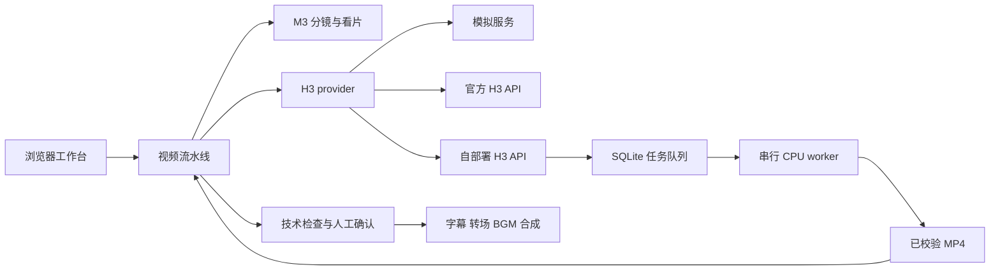

# MiniMax H3 Studio

把商品图或人物参考图变成可编辑的分镜，再逐镜生成、质检并合成视频。项目同时提供一套 **MiniMax V2 风格的 H3 CPU 推理 API**，可以独立使用，也可以接入视频流水线。

这是一套单用户实验与创作工具。默认使用不调用付费模型的模拟服务；自部署模式只实现 **单图 Ref2VA**，并非 MiniMax 官方托管服务的全部功能。

## 先选择使用方式

| 方式 | 需要准备 | 能验证什么 |
| --- | --- | --- |
| 本地模拟体验 | Python 3.12、FFmpeg | 项目、分镜确认、队列、质检、重试与合成；视频由模拟器生成 |
| 调用官方服务 | MiniMax API Key 及可用模型权限 | M3 写脚本、H3 逐镜生成、M3 看片；按服务商规则计费 |
| 自部署 H3 | Linux x86_64、大内存 CPU、H3 权重及独立 API Key | 单张参考图生成音视频，通过异步 API 调用 |

**已有实测：**自部署 H3 API 在 160 vCPU / 768 GiB 的 CPU 实例上完成了一个 5 秒、768×768、120 帧、24 fps 的真实 Ref2VA 请求，音轨为 32 kHz 双声道，约耗时 111 分钟。断线后按原任务 ID 恢复、API 重启后的查询与下载均通过。此前独立 runner 还生成了 15 秒电影人物片，耗时约 14 小时 21 分钟。不同输入、时长和画布不能直接套用这些速度。

模拟流水线的完整闭环与真实 H3 API 的验收分别有记录；尚未把所有官方调用、全部画幅和整个多镜头流水线逐项做真实模型验收。详见 [验证范围](docs/validation.md)。

## 快速体验

要求 Python 3.12，以及 PATH 中可用的 `ffmpeg`、`ffprobe`。Linux 合成中文字幕建议安装 Noto Sans CJK；macOS 可使用系统中文字体。

```bash
git clone https://github.com/yyh-steve/minimax-h3-studio.git
cd minimax-h3-studio/pipeline/backend

python3.12 -m venv .venv
.venv/bin/python -m pip install -r requirements.lock
cp .env.example .env
.venv/bin/python -m uvicorn app.main:app --host 127.0.0.1 --port 8000
```

打开 <http://127.0.0.1:8000>，按下面的顺序使用：

1. 创建项目，填写商品名、卖点、画幅和目标时长，上传自己的参考图。
2. 生成并编辑商品理解卡与分镜，完成规则校验和评审。
3. 点击确认后开始逐镜生成。**确认前不会提交 H3 任务。**
4. 查看技术质检及看片结果，需要时修改或手动重试单个镜头。
5. 选择已采纳的镜头，设置字幕、转场和 BGM，合成并下载 MP4。

默认 `H3_PROVIDER=mock`、`M3_PROVIDER=mock`，无需密钥；这时分镜与视频均为模拟结果，用于体验流程。源码不需要 Node.js 构建：前端是由 FastAPI 托管的 HTML/JavaScript 单页。

如果 8000 端口已被其他程序占用，可同时调整 `.env` 中的 `PORT` 和启动命令的 `--port`，然后打开对应地址。

## 项目组成

```text
minimax-h3-studio/
├── pipeline/                 # 项目、分镜、素材、质检与合成工作台
│   └── backend/
│       ├── app/              # API、状态库、模型 provider、流水线
│       ├── web/              # 无需构建的 Web 页面
│       └── tests/
├── h3-api/                   # 单图 Ref2VA 的异步 V2 接口
│   ├── h3_api/               # 鉴权、SQLite、worker、媒体校验
│   ├── deploy/               # systemd 文件生成器
│   └── examples/client.py    # 提交与断线恢复客户端
├── cpu-runtime/              # CPU runner、下载清单、来源审计与测试
├── docs/
│   ├── deployment.md         # 从零安装 CPU 模型与 API
│   ├── integration.md        # 官方服务和自部署服务接入
│   ├── validation.md         # 测试方法、实测与限制
│   ├── Minimax H3部署方案.docx
│   └── media/                # 已核验的真实生成示例
└── .github/workflows/        # 不加载模型权重的自动检查
```



流水线与 H3 API 使用不同的数据目录和 Python 环境。网页进程不会加载 H3 权重；CPU worker 也不会执行前端业务。两者通过 HTTP 交互，不要求放在同一台机器。

## 功能与边界

- **分镜与 Take 分开：**保留每次生成记录；改稿后按内容指纹只生成变化的镜头。
- **人工确认闸门：**先确认分镜，再开始生成；技术检查、模型评审与人工采纳各自保留状态。
- **恢复长任务：**已有任务 ID 时继续查询和下载。提交超时进入对账，不因连接中断直接重提。
- **合成：**FFmpeg 归一化、硬切或淡入淡出、Pillow 字幕、BGM 混音，导出 H.264 + AAC。
- **本地 H3 API：**单图、768P 档位、4–15 秒整数时长、固定画布；不支持首尾帧、多图、2K、回调或水印生成。

CPU 生成可能耗时数小时，流水线的“输出秒数预算”不是云费用上限。自部署前阅读 [部署指南](docs/deployment.md)；使用本地 H3 时先从一个短镜头开始，并控制自动重试。停止应用或结束模型作业不等于云实例停止计费。

## 接入真实模型

三种配置示例和接入检查见 [接入指南](docs/integration.md)。

- M3 使用 OpenAI 兼容的 Chat Completions，地址通常包含 `/v1`。
- H3 使用 `/v2/video_generation`、任务查询与下载接口；地址不附加 `/v1`。
- 自部署 H3 使用自己的 H3 API Key，与官方 M3 的密钥分别配置。
- 运行配置与素材在本地保存；官方模式或远程模型模式会将所需请求及素材发送到配置的服务。

工作台没有多租户鉴权，按默认设置只绑定回环地址。需要远程使用时优先通过 SSH 隧道，不要直接把未加鉴权的工作台暴露到公网。

## 开发与验证

[验证指南](docs/validation.md)提供流水线、API、CPU 轻量回归与安装环境检查命令。自动化测试使用临时状态目录和合成媒体，不自动创建云资源或下载模型权重。

真实结果可直接查看：[5 秒 API 样例](docs/media/h3-api-ref2va-5s.mp4) · [15 秒电影人物样例](docs/media/h3-cinematic-15s.mp4)。

完整的资源选型、公开价格口径、部署过程及 API 开发方案见 [Word 部署方案](docs/Minimax%20H3部署方案.docx)。文档内包含原始视频附件；是否能直接激活播放取决于 Word 客户端，独立 MP4 可直接使用。

## 许可证与来源

模型权重、框架和样例素材保留各自的许可与使用条件，见 [THIRD_PARTY_NOTICES.md](THIRD_PARTY_NOTICES.md)。仓库不包含模型权重、真实密钥、任务数据库或内部云账号记录。当前没有为原创项目代码另行指定统一的开源许可证。
