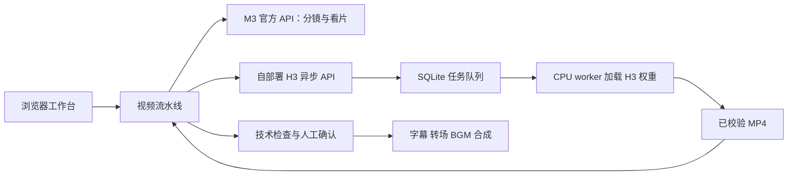

# MiniMax H3 Studio

本项目回答一个具体需求：**如何自己部署一个 MiniMax H3 模型，并封装成 API。** 模型权重和推理程序运行在自己的服务器上，接收一张参考图与提示词，完成单图 Ref2VA 音视频生成；应用通过 **MiniMax V2 风格的异步 API** 提交任务、查询状态和下载视频。

选型从调研 H3 的模型组成和部署条件开始：对照官方模型卡、框架配方与权重清单，评估自己的 **RTX 5060 Ti 16 GB 显存＋32 GB 系统内存**。16 GB 显存无法承载本方案的完整 BF16/FP32 组件常驻，32 GB 系统内存也不足以满足所查 INT8＋CPU 卸载配方约 75 GB 的主机权重承载条件，还要另留加载和系统空间；因此当前整机不满足所选路线。随后检查公司现有云账号中的 veMLP、GPU ECS 和容器资源，结合权限、规格、库存与成本，最终使用能够开通的 **160 vCPU / 768 GiB CPU ECS**，完成单图 Ref2VA 与 API 封装。

5060 Ti 16 GB 配合更大主机内存，仍可选择量化和分层卸载路线；内存升级可按 128–256 GB 作工程规划，256 GB 余量更宽裕，具体工作流与画布按配方配置。本方案保留固定版本的原始权重与 768P 目标，利用可获得的大内存服务器完成生成。CPU 推理耗时较长，因此 API 返回任务 ID，独立 worker 在后台串行执行，客户端按任务 ID 获取结果。

## 整体思路

1. **先弄清 H3 要求。** 阅读官方模型卡、Diffusers 与 SGLang 配方，列出 Transformer、条件编码器和双 VAE，分别核算权重文件、显存、主机内存、磁盘与软件要求。
2. **对照设备，再筛选云资源。** 分别评估自己的 RTX 5060 Ti 16 GB 显存与 32 GB 系统内存，再检查公司可用云账号中的 veMLP、GPU ECS 和容器产品，结合整机配置、权限、库存和成本选择可开通的大内存 CPU ECS。
3. **分阶段建立 CPU 推理。** 固定 PyTorch CPU、框架源码与模型版本，检查 CPU 算子和运行内存，再由短任务推进到完整单图 Ref2VA，串起参考图、提示词、采样、解码和 MP4 输出。
4. **将推理封装为异步 API。** FastAPI 负责鉴权与请求处理，SQLite 保存任务与状态，独立 worker 串行调用 runner。客户端提交后获得 `task_id`，再查询状态并使用结果中的下载链接获取 MP4。
5. **接入自己的应用。** 可直接使用 HTTP 或示例客户端调用 H3，也可接入仓库中的视频工作台；工作台进一步提供分镜管理、质检和成片合成。M3 是可选的上层分镜与看片服务，通过独立配置的官方 API 调用。

```text
生成：参考图 + 提示词 → H3 异步 API → SQLite 任务队列 → CPU worker / H3 runner → MP4
取回：客户端持有 task_id → 查询任务状态 → 获取结果下载链接 → 下载 MP4
```

调研方法、设备判断和资源选择过程见 [前期调研与选型](docs/research-and-selection.md)；安装步骤见 [CPU 部署指南](docs/deployment.md)，接口参数与调用方式见 [H3 API 说明](h3-api/README.md)。需要图形化创作流程时，再按下文安装视频工作台。

## GPU 应该怎样选择

H3 的 GPU 需求取决于精度与组件放置。上游提供 **单 80 GB＋CPU 卸载、双 80 GB 按组件分卡、4×H100 80 GB＋TP2/Ulysses2、4×H200 141 GB＋Ulysses4** 等路线；消费级 16/24/32 GB 则结合量化、逐层卸载与主机 RAM 规划。双 5090 的原精度配方还需要 384 GiB 级主机内存。

完整对照见 [GPU 选型指南](docs/gpu-selection.md)：包含 A100/H100/H200 的不同形态、5060 Ti/4090/5090、双 48 GB 卡和 V100/T4，以及每卡显存、互联与 RAM 的判断。GPU 路线采用上游 SGLang/Diffusers；本仓库的安装步骤和 API worker 对应下面的 CPU 实现。

## 方案组成

| 组件 | 部署位置 | 职责 |
| --- | --- | --- |
| H3 CPU 运行时 | Linux x86_64 大内存云服务器 | 加载 H3 权重，执行单图 Ref2VA 音视频生成 |
| H3 异步 API | 与模型运行时同一主机 | 鉴权、排队、任务查询、幂等提交与视频下载 |
| 视频工作台 | 本机或独立服务器 | 参考图、分镜编辑、生成看板、质检与成片管理 |
| M3 | 官方 API，由工作台调用 | 图片理解、分镜编写、分镜评审与可选看片 |
| FFmpeg | 工作台所在主机 | 媒体检查、字幕、转场、BGM 和 MP4 合成 |

**生成样例：**自部署 H3 API 在 160 vCPU / 768 GiB 的 CPU 实例上生成了 [5 秒 Ref2VA 视频](docs/media/h3-api-ref2va-5s.mp4)：768×768、120 帧、24 fps、32 kHz 双声道，约耗时 111 分钟。独立 CPU runner 生成的 [15 秒电影人物视频](docs/media/h3-cinematic-15s.mp4)耗时约 14 小时 21 分钟。耗时随输入、时长和画布变化，完整记录见 [验证指南](docs/validation.md)。

## 部署与启动

### 1. 部署自己的 H3 服务

按 [CPU 部署指南](docs/deployment.md)准备 Linux x86_64 主机、模型权重和独立的 API 环境，启动 H3 API 与串行 worker。参考资源为 160 vCPU / 768 GiB；runner 的运行前检查要求至少 256 GiB 当前可用内存，数据盘建议起步至少 300 GiB 可用空间。

H3 API 默认监听 `127.0.0.1:30010`。工作台与云服务器不在同一台机器时，在工作台所在电脑建立隧道，并保持该终端运行：

```bash
ssh -N -L 127.0.0.1:30010:127.0.0.1:30010 USER@ECS_HOST
```

将 `USER` 和 `ECS_HOST` 替换为自己的登录名和服务器地址。此方式下，服务端 `H3_PUBLIC_BASE_URL` 与工作台 `H3_BASE_URL` 均配置为 `http://127.0.0.1:30010`，任务查询和视频下载共用该隧道。

### 2. 安装视频工作台

工作台要求 Python 3.12，以及 PATH 中可用的 `ffmpeg`、`ffprobe`。Linux 合成中文字幕建议安装 Noto Sans CJK；macOS 可使用系统中文字体。

```bash
git clone https://github.com/yyh-steve/minimax-h3-studio.git
cd minimax-h3-studio/pipeline/backend

python3.12 -m venv .venv
.venv/bin/python -m pip install -r requirements.lock
cp .env.local.example .env
```

### 3. 配置自部署 H3 与 M3

编辑刚复制的 `.env`，将对应项设为下面的值，并填写两个服务各自的密钥。模板中的 M3 默认值为 `mock`，按本方案使用时改为 `official`：

```dotenv
H3_PROVIDER=local
H3_BASE_URL=http://127.0.0.1:30010
H3_API_KEY=
M3_PROVIDER=official
M3_BASE_URL=https://api.minimax.cn/v1
M3_API_KEY=
M3_TAKE_REVIEW=true
MAX_CONCURRENCY=1
AUTO_RETRY_LIMIT=0
HOST=127.0.0.1
PORT=8100
```

`H3_API_KEY` 填写自己部署的 H3 服务密钥，至少 24 位无空白 ASCII 字符；`M3_API_KEY` 填写官方 M3 密钥，M3 地址与模型权限以自己的控制台为准。`M3_TAKE_REVIEW=true` 开启生成后的 M3 看片；设为 `false` 时保留技术检查。已有安装直接编辑原配置，不覆盖 `.env`。

### 4. 启动并创作

在 `pipeline/backend` 中启动：

```bash
.venv/bin/python -m uvicorn app.main:app --host 127.0.0.1 --port 8100
```

打开 <http://127.0.0.1:8100>，按下面的顺序使用：

1. 创建项目，填写商品名、卖点、画幅和目标时长，上传自己的参考图。
2. 生成并编辑理解卡与分镜；每镜选择“参考图”模式，使用一张参考图、`MiniMax-H3`、`768P` 和 4–15 秒整数时长，完成规则校验和评审。
3. 点击确认后开始逐镜生成。**确认前不会提交 H3 任务。**
4. 查看技术质检及看片结果，需要时修改或手动重试单个镜头。
5. 选择已采纳的镜头，设置字幕、转场和 BGM，合成并下载 MP4。

前端是由 FastAPI 托管的 HTML/JavaScript 单页，无需 Node.js 构建。项目总时长可拆为多个镜头，每镜由自部署 H3 独立生成。

如果 8100 端口已被其他程序占用，可同时调整 `.env` 中的 `PORT` 和启动命令的 `--port`，然后打开对应地址。

## 项目组成

```text
minimax-h3-studio/
├── pipeline/                 # 项目、分镜、素材、质检与合成工作台
│   └── backend/
│       ├── app/              # API、状态库、模型 provider、流水线
│       ├── web/              # 无需构建的 Web 页面
│       └── tests/
├── h3-api/                   # 单图 Ref2VA 的异步 V2 接口
│   ├── h3_api/               # 鉴权、SQLite、worker、媒体校验
│   ├── deploy/               # systemd 文件生成器
│   └── examples/client.py    # 提交与断线恢复客户端
├── cpu-runtime/              # CPU runner、下载清单、来源审计与测试
├── docs/
│   ├── research-and-selection.md # H3 条件、本地 GPU 评估与云资源选择
│   ├── gpu-selection.md      # GPU 型号、每卡显存、并行与整机内存
│   ├── deployment.md         # 从零安装 CPU 模型与 API
│   ├── integration.md        # 自部署 H3 与 M3 接入配置
│   ├── validation.md         # 测试方法、实测与限制
│   ├── Minimax H3部署方案.docx
│   └── media/                # 已核验的真实生成示例
└── .github/workflows/        # 不加载模型权重的自动检查
```



流水线与 H3 API 使用不同的数据目录和 Python 环境。网页进程不会加载 H3 权重；CPU worker 也不会执行前端业务。两者通过 HTTP 交互，不要求放在同一台机器。

## 项目能力

- **分镜与 Take 分开：**保留每次生成记录；改稿后按内容指纹只生成变化的镜头。
- **人工确认闸门：**先确认分镜，再开始生成；技术检查、模型评审与人工采纳各自保留状态。
- **恢复长任务：**已有任务 ID 时继续查询和下载。提交超时进入对账，不因连接中断直接重提。
- **合成：**FFmpeg 归一化、硬切或淡入淡出、Pillow 字幕、BGM 混音，导出 H.264 + AAC。
- **自部署 H3 API：**单图 Ref2VA、768P 档位、4–15 秒整数时长、固定画布；详细请求参数见 [API 说明](h3-api/README.md)。

CPU 生成可能耗时数小时，流水线的“输出秒数预算”不是云费用上限。自部署前阅读 [部署指南](docs/deployment.md)；使用本地 H3 时先从一个短镜头开始，并控制自动重试。停止应用或结束模型作业不等于云实例停止计费。

## 接口与配置

服务连接、配置项和长任务恢复见 [接入指南](docs/integration.md)。

- M3 使用 OpenAI 兼容的 Chat Completions，地址通常包含 `/v1`。
- H3 使用 `/v2/video_generation`、任务查询与下载接口；地址不附加 `/v1`。
- 自部署 H3 使用自己的 H3 API Key，与官方 M3 的密钥分别配置。
- H3 请求与参考图发送到自己部署的服务；M3 所需文本、图片及看片视频发送到配置的 M3 API。

工作台没有多租户鉴权，按默认设置只绑定回环地址。需要远程使用时优先通过 SSH 隧道，不要直接把未加鉴权的工作台暴露到公网。

## 开发与验证

[验证指南](docs/validation.md)提供流水线、API、CPU 轻量回归与安装环境检查命令。自动化测试使用临时状态目录和合成媒体，不自动创建云资源或下载模型权重。

真实结果可直接查看：[5 秒 API 样例](docs/media/h3-api-ref2va-5s.mp4) · [15 秒电影人物样例](docs/media/h3-cinematic-15s.mp4)。

完整的资源选型、公开价格口径、部署过程及 API 开发方案见 [Word 部署方案](docs/Minimax%20H3部署方案.docx)。文档内包含原始视频附件；是否能直接激活播放取决于 Word 客户端，独立 MP4 可直接使用。

## 许可证与来源

模型权重、框架和样例素材保留各自的许可与使用条件，见 [THIRD_PARTY_NOTICES.md](THIRD_PARTY_NOTICES.md)。仓库不包含模型权重、真实密钥、任务数据库或内部云账号记录。当前没有为原创项目代码另行指定统一的开源许可证。
